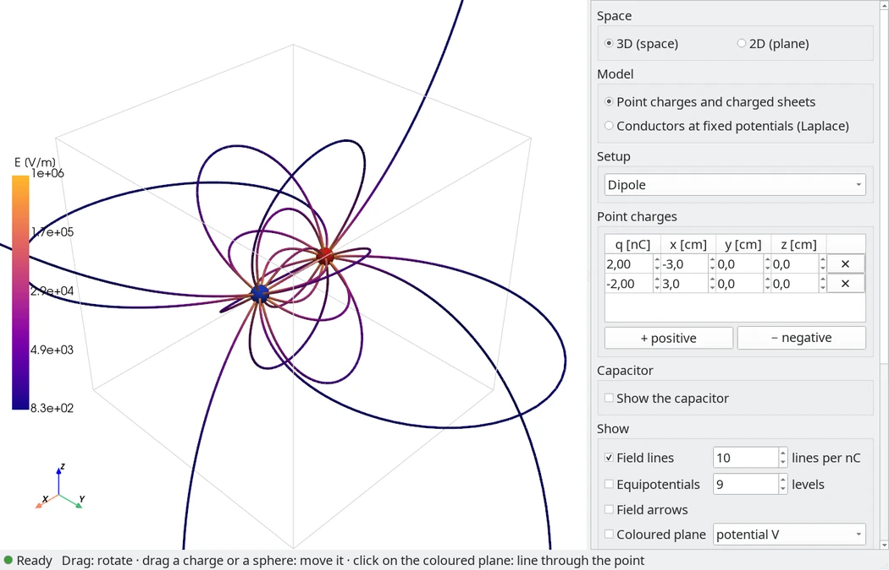
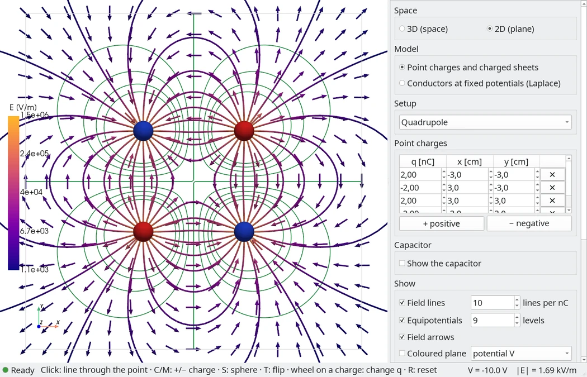
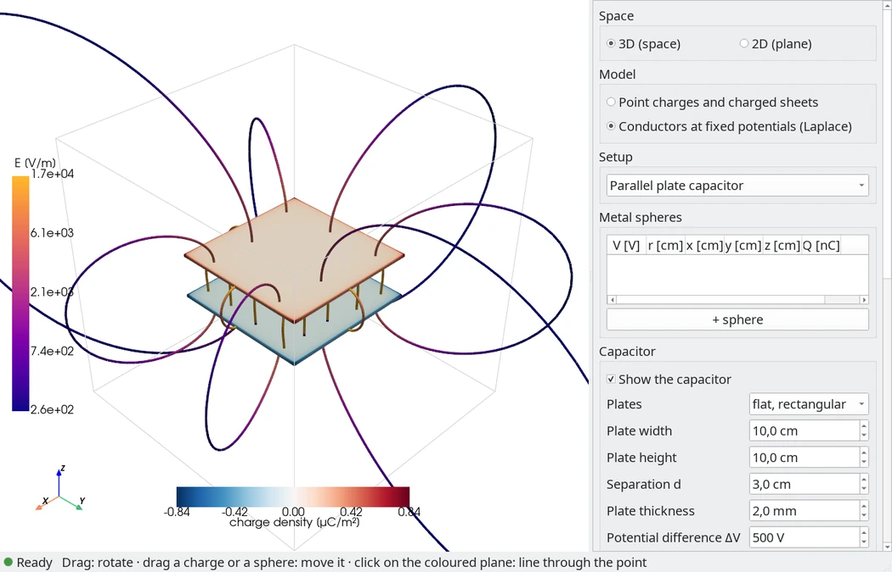
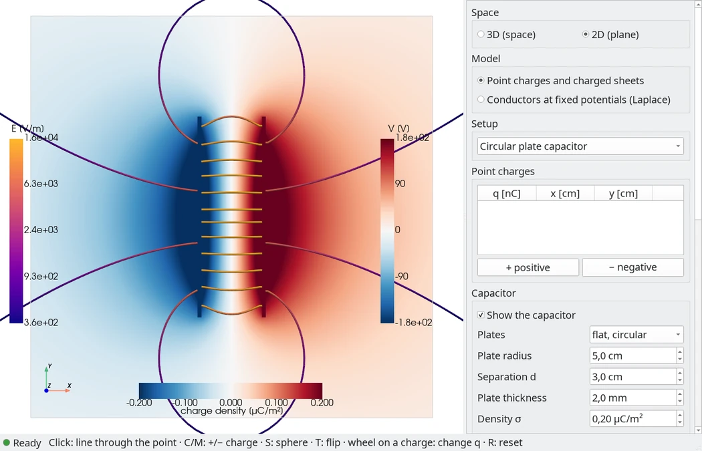
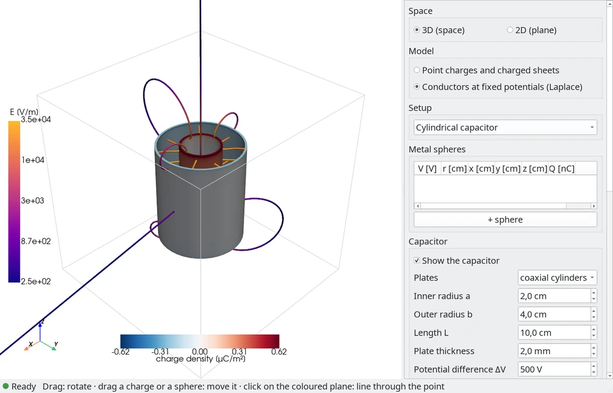
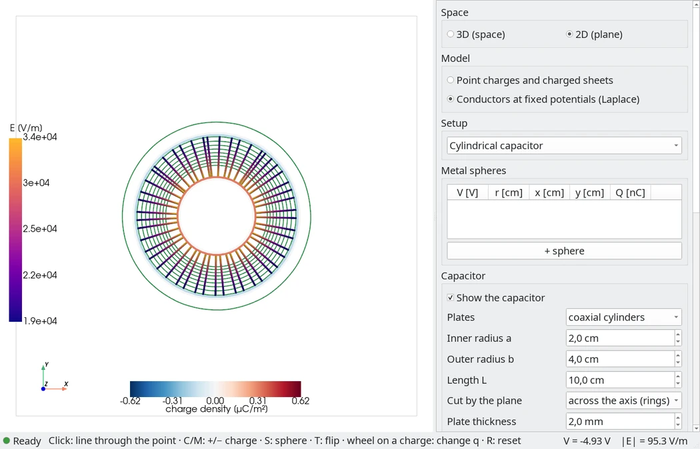
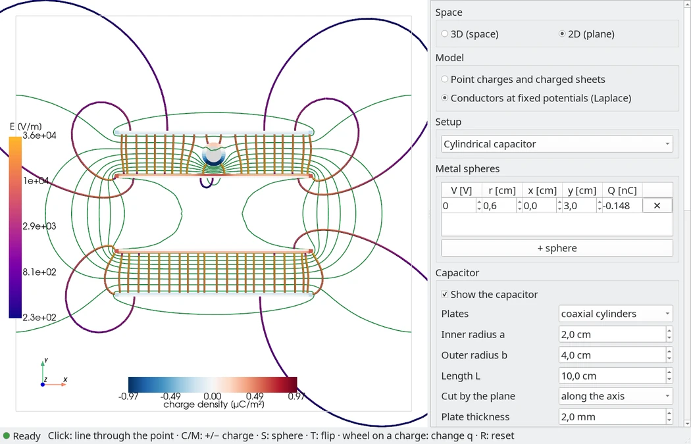
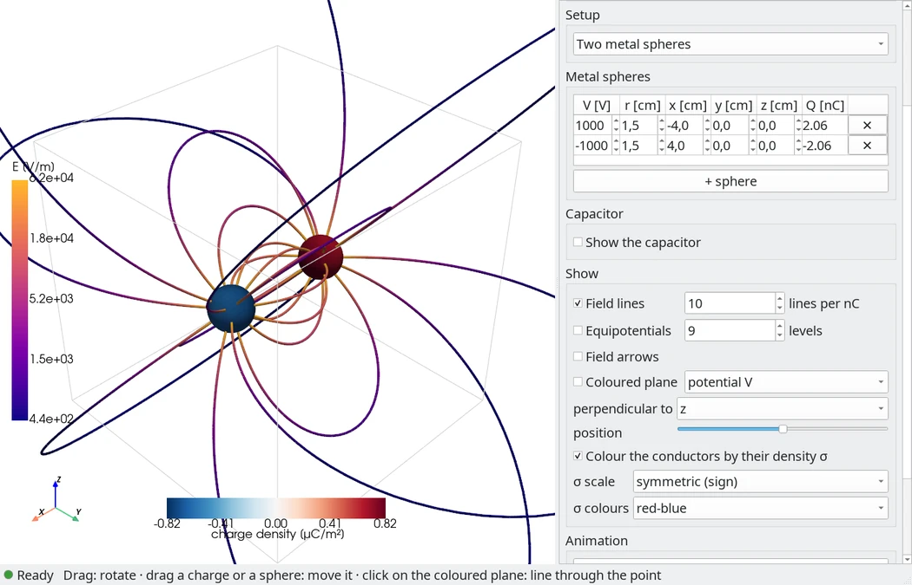

# field-lines

Electric field lines, equipotentials and capacitors, in 3D space or in a 2D
plane, with a Qt window around a [PyVista](https://pyvista.org) 3D view.
The interface speaks Italian and English.

Two models:

- **Point charges and charged sheets:** place charges, drag them, change
  them, and watch the field lines grow out of the positive charges and end
  on the negative ones; a capacitor whose plates carry a uniform surface
  charge.
- **Conductors at fixed potentials (Laplace):** metallic spheres, each held
  at its potential, and a capacitor whose plates are held at a potential
  difference. Their charges are solved, and the surfaces are coloured by
  their charge density.

The capacitor has flat plates, rectangular or circular, or is cylindrical:
two coaxial tubes of finite length.

In both, the capacitor's E, ΔV, Q and C are read out, and the field can be
shown as field lines, equipotential surfaces (lines in 2D), an arrow grid,
and a movable plane coloured by V or |E|.

## Screenshots

<table>
  <tr>
    <td width="50%"><br>
      A dipole in 3D: the lines leave the + charge and end on the − one.</td>
    <td width="50%"><br>
      A quadrupole in the 2D plane, with equipotentials and field arrows.</td>
  </tr>
  <tr>
    <td><br>
      Parallel plates held at ΔV = 500 V: their faces coloured by the solved charge density.</td>
    <td><br>
      Circular plates with uniform σ, cut by the plane, which is coloured by V.</td>
  </tr>
  <tr>
    <td><br>
      A cylindrical capacitor: two coaxial tubes of finite length.</td>
    <td><br>
      Cut across its axis: a radial field and circular equipotentials.</td>
  </tr>
  <tr>
    <td><br>
      Cut along its axis, with a grounded sphere in the gap: the field leaks out of the open ends.</td>
    <td><br>
      Two metal spheres at ±1000 V, coloured by their surface charge density.</td>
  </tr>
</table>

## Run

```bash
uv run field-lines                      # 3D, dipole, language of the system
uv run field-lines --mode 2d            # the 2D plane, like the old pygame app
uv run field-lines --preset capacitor   # empty, single, dipole, equal, quadrupole, capacitor,
                                        # disc_capacitor, cylindrical_capacitor,
                                        # sphere, two_spheres, sphere_in_capacitor
uv run field-lines --lang en            # it or en
```

Python 3.14; `uv` installs everything else (PySide6, pyvistaqt, PyVista/VTK,
NumPy, SciPy).

## Using it

The panel on the right holds:

- **2D / 3D:** going to 2D moves the charges and spheres onto the z = 0
  plane and turns a capacitor so that its plates cross the plane (a
  cylinder is cut across its axis or along it, as the capacitor form says).
- **Model:** point charges and charged sheets, or conductors at fixed
  potentials.
- **Setup:** ready-made setups. Those with spheres switch to the conductors
  model, those with charges to the charges model.
- **Point charges** (charges model): a table of q (nC) and x, y, z (cm), plus
  buttons to add or remove charges.
- **Metal spheres** (conductors model): a table of potential V, radius and
  centre (cm), with each sphere's charge Q, plus buttons to add or remove
  spheres.
- **Capacitor:** the plates' shape, then
  - flat rectangular plates: width, height and separation d (the gap
    between the plates' inner faces);
  - flat circular plates: radius and separation d;
  - coaxial cylinders: the inner radius a (of the inner tube's outer face),
    the outer radius b (of the outer tube's inner face), the length L, and
    in 2D whether the plane cuts them across the axis (two rings, a radial
    field) or along it (four strips, with the field leaking out of the open
    ends);
  - the plates' thickness (0.5 to 10 mm, 2 mm to start with): each plate is
    a closed body, a slab, a disc or a tube, growing away from the gap (the
    inner tube grows inwards, into a rod if it is thicker than a);
  - σ of the positive plate (charges model; on a cylinder, of the inner
    tube: the outer one gets the opposite charge, so σ·a/b) or ΔV
    (conductors model).
- **Show:** field lines (lines per nC), equipotentials (number of levels),
  arrows, the coloured plane (V or |E|, its axis and position), whether
  plates and spheres are coloured by their surface charge density (on to
  start with; off, the plates are plain red and blue and the spheres grey),
  and how σ is coloured:
  - scale *symmetric*: centred on 0, red + and blue − (with the red-blue
    palette): shows the sign;
  - scale *contrast*: from the smallest to the largest σ shown (2nd to 98th
    percentile), so that small differences spread over the whole palette;
    it never spans less than 2% of the typical σ, because the conductors
    are solved to a few tenths of a percent and finer differences would
    only show the panels;
  - scale *logarithmic*: |σ| on a log scale, for differences of orders of
    magnitude (a plate's outer face against its edges), and to see the
    variations on each of several spheres of opposite signs;
  - palette: red-blue, viridis, plasma, turbo, cividis or greys.
- **Animation:** replay the growth of the lines, and set its speed.
- **Language.**

In the view:

| | 3D | 2D |
|---|---|---|
| left drag | rotate | pan |
| right drag / wheel | zoom | zoom |
| drag a charge or a sphere | moves it parallel to the screen | moves it in the plane |
| click | on the coloured plane: a field line through that point | a field line through that point |
| wheel on a charge | changes q by 0.25 nC | changes q by 0.25 nC |
| `C` / `M` | add a +2 / −2 nC charge under the mouse | same |
| `S` | add a metal sphere at 1000 V under the mouse (conductors model) | same |
| `T` | flip the sign of the charge under the mouse | same |
| `R` | clear everything | same |

The status bar shows, on the left, what the program is doing: a green light
and "Pronto" (ready), a flashing amber light while the conductors are being
solved or the equipotentials and the plane are recomputed in the
background, or a red light if spheres touch. On the right it shows V and
|E| under the mouse: anywhere in 2D, on the coloured plane in 3D.

## The physics

Everything inside is in SI units; the panel shows nC, cm, μC/m², V, V/m, pF.

**Field lines.**
- The number of lines leaving a source is proportional to its charge
  ("lines per nC"). Each line ends on a source of the opposite sign or goes
  off to infinity, so this is Gauss's law you can see.
- In 3D the lines start evenly spread on a small sphere around each charge
  (a Fibonacci sphere).
- In 2D they start evenly on a circle in the plane. These are still the
  lines of 3D point charges, cut by the plane, as in the old app.
- From a plate or a sphere, lines start in proportion to the flux leaving
  each part of its surface. That is why only a few leave a plate's outer
  face, and why on conductors they crowd where the charge does. On a
  conductor in 3D the flux leaving each panel is its charge over ε₀, so the
  solved charges give it without evaluating the field. The
  surface is cut in two again and again, each part with flux in proportion
  to the lines it gets, until each part has one line, which starts at the
  part's centre of flux: the lines spread evenly, not in rows.
- Lines start from the sign with the larger total charge: forward along E
  from + sources, or backwards from − sources when the negative charge is
  larger. A conductor may be positive in some parts and negative in others
  (a grounded sphere between the plates is both): its lines are as many as
  the charge of its parts of that sign.

**Tracing.**
- All lines advance together, with RK4 along the unit vector of E, so the
  parameter is the arc length (this is also what the growth animation
  uses).
- The step is proportional to the distance from the nearest point charge,
  and it is halved where a line bends sharply.
- Lines are followed far outside the view, up to 100 m, with steps that
  grow with the distance. A line leaving a capacitor's outer face can make
  a loop metres wide before it comes back to the negative plate; this way
  every line of a neutral setup (capacitor, dipole, quadrupole) ends on a
  negative source. Only setups with a net charge send lines to infinity.
- The growth animation skips the parts of a line outside the view: a line
  leaves the screen and reappears where it comes back.
- A line stops at an opposite charge or plate, on any conductor (plate or
  sphere) in the conductors model, at a null point (where it turns back on
  itself), or 100 m away. It is drawn only within half a metre of the
  centre: VTK fits its camera's depth range to everything drawn, and lines
  100 m long made clicks so imprecise that a sphere caught every drag and
  the view could not be rotated.

**Uniform-σ plates.** E and V of a uniformly charged rectangle come from
their closed-form integrals, not from summing many small charges. In the
middle of a large capacitor this gives the textbook σ/ε₀ (checked in the
tests). A uniformly charged disc is a regular polygon of 48 sides, and a
cylindrical sheet a prism of 48 flat strips, each counted with the exact
field of a flat polygon; the polygon is a little larger than the circle, so
that it has the same area and carries the same charge. 1 mm off the sheet
this is within 0.5% of σ/ε₀ of the round sheet. The charged sheet is the
plate's face towards the gap; the body is drawn behind it, and the lines
start from and end on its surface.

**Conductors.** Each sphere is held at its potential V with respect to
infinity, alone in empty space. The capacitor's plates are held ΔV apart
and carry equal and opposite charges: they are at V₀ ± ΔV/2, with V₀ found
so that their charges add up to zero (0 for symmetric plates; not for two
coaxial tubes, where the larger outer one would otherwise take more charge
from infinity). The charges are found on the surfaces (boundary elements,
or the method of moments):
- each surface is cut into small flat panels with a uniform σ: a
  rectangular plate is a box, each large face cut into 21 × 21 panels,
  finer towards its edges, and its four rims into strips across the
  thickness; a disc or a tube has a polar grid of 40 panels around, a
  disc's flat faces 12 rings of them finer towards the rim (triangles at the
  centre), a tube up to 20 rows along it, finer towards its ends; a sphere
  is cut into 384 panels, a cube projected onto it;
- each panel counts with its true shape (the closed-form potential and field
  of a flat polygon). The cube's corners make kite-shaped panels on a
  sphere; counting them as squares had left σ 7% off there. Now an isolated
  sphere's σ is uniform to 0.2%;
- the densities are chosen so that the centre of every panel is at its
  conductor's potential. That solves Laplace's equation outside the
  conductors, with V → 0 far away, without a grid;
- a panel acts as a uniformly charged rectangle (closed form) on points
  within 4 panel sizes, and as a point charge farther away; far from a group
  of panels, the group acts as one charge and a dipole. That keeps the
  field quick to evaluate, also far out where field lines loop.

A new potential is solved at once; moving or resizing a sphere, or
changing the plates, takes a fraction of a second (the solve runs in the
background, and the old lines stay meanwhile). Spheres may not touch each
other or the plates. In this model the point charges do not take part.

From the panels' charges the panel shows Q, C = Q/ΔV (larger than the
ideal value because of fringing, and a little larger with thicker plates,
whose rims also carry charge) and each sphere's Q. Each face of a plate
carries σ = ε₀ E just outside it. The inner faces of flat plates carry
σ = ε₀ΔV/d in the middle, the outer faces much less, and the charge crowds
towards the edges and onto the rims. Between two tubes the field falls off
as 1/r, and inside the inner tube, away from its open ends, there is
hardly any charge.

Coloured by density, a plate shows each of its faces with its own σ. In 2D
its cut through the plane is a rectangle, its half towards the gap coloured
by that face, its other half by the opposite face, and its ends by the rims;
a tube cut across its axis is a ring, its inner and outer halves coloured by
its two cylinders (a rod is grey inside, with a coloured rim). A sphere
shows its whole surface in 3D, a ring along its cut in 2D. A grounded sphere
between the plates has no net charge, but is negative on the side facing the
+ plate and positive on the other. A uniform-σ plate is one colour.

**Readouts.**
- Flat plates: E at the centre, against σ/ε₀ with σ = Q/A, the field of
  infinite plates with the same charge; ΔV between the centres of the
  plates' inner faces; Q, C, and ε₀A/d.
- Cylinder: E halfway across the gap in the middle of its length, against
  λ/(2πε₀r) with λ = Q/L, the field of infinite tubes; ΔV between the two
  tubes' faces across the gap; Q, C, and 2πε₀L/ln(b/a).

## Tests

```bash
uv run pytest
```

**Physics:**
- The plate's closed form against brute-force sums.
- The capacitor's textbook limits.
- Field lines: dipole symmetry, null points, line counts, speed, and
  regression tests for the old app's freezes.
- The conductors model:
  - an isolated sphere: Q = 4πε₀RV, uniform σ = ε₀V/R, the field of a point
    charge outside and none inside;
  - the plates at ±ΔV/2, the gap field ΔV/d, Q₊ = −Q₋, a dipole far away;
  - convergence of C, and agreement with Kirchhoff's fringing estimate,
    for square and for circular plates;
  - two coaxial tubes: equal and opposite charges at the asked ΔV, a 1/r
    field across the gap, C above 2πε₀L/ln(b/a), no charge inside;
  - the polygon and prism sheets against a uniformly charged disc's exact
    field on its axis and a long tube's λ/(2πε₀r);
  - more charge at the edges, and the two faces adding up;
  - Gauss's law around each plate;
  - the grounded sphere between the plates: neutral, charged on each side;
  - the grouped panels against the panel-by-panel sum;
  - every line starting and ending on a conductor, in 2D staying in the plane.

**Render tests** draw off-screen with PyVista. **GUI tests** drive the real
window on Qt's offscreen platform, without drawing (VTK has no OpenGL context
there). Some of them send real Qt mouse, wheel and key events to the 3D
view: a click versus a drag, the wheel on a charge versus on empty space,
dragging a charge or a sphere, and the keys.

## Layout

```
src/field_lines/
  units.py        SI constants, display units, formatting of readouts
  sources.py      point charges, plates (closed form), discs and tubes (their geometry)
  conductors.py   conductors at fixed potentials: surface charges by boundary elements
  seeding.py      where lines start (number proportional to charge or flux)
  tracing.py      vectorized RK4 tracing with its stopping rules
  sampling.py     grids for equipotentials, arrows and the coloured plane
  scene.py        what is shown (model, sources, 2D/3D); no Qt
  presets.py      ready-made setups
  view.py         PyVista actors and the 2D/3D camera
  interaction.py  draggable charges and spheres, clicks, screen <-> world
  panel.py        the Qt side panel
  strings.py      every visible text, in Italian and English
  app.py          the main window, which wires everything together
```

To change a label or a translation, edit `strings.py`.
